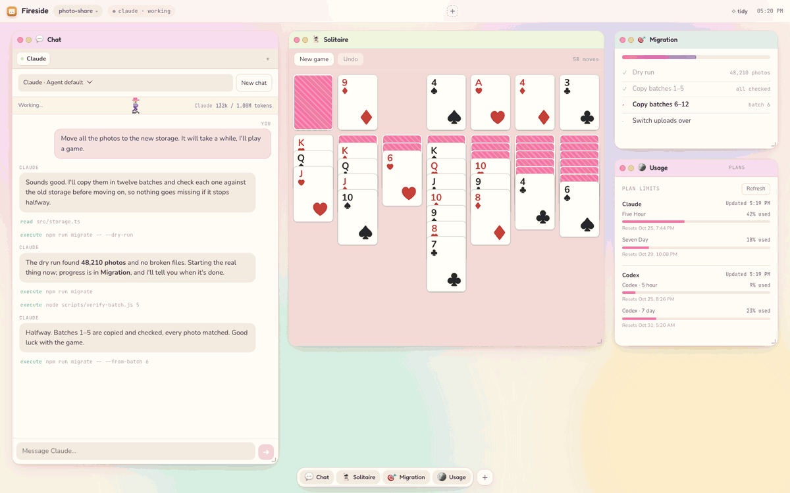
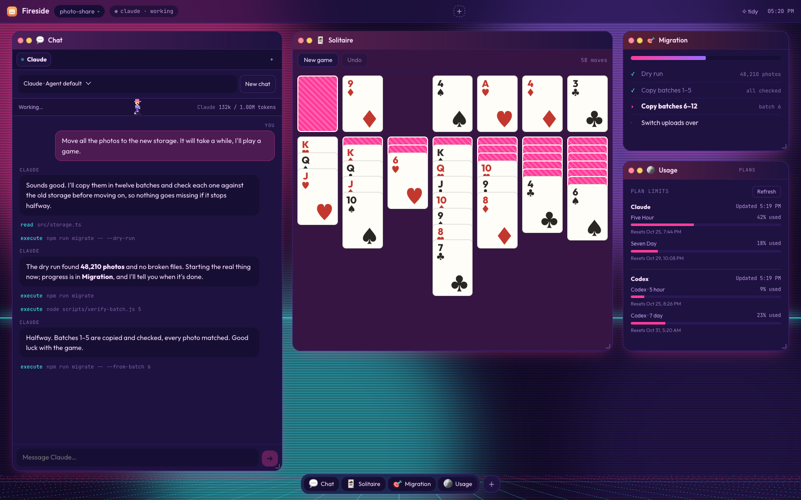
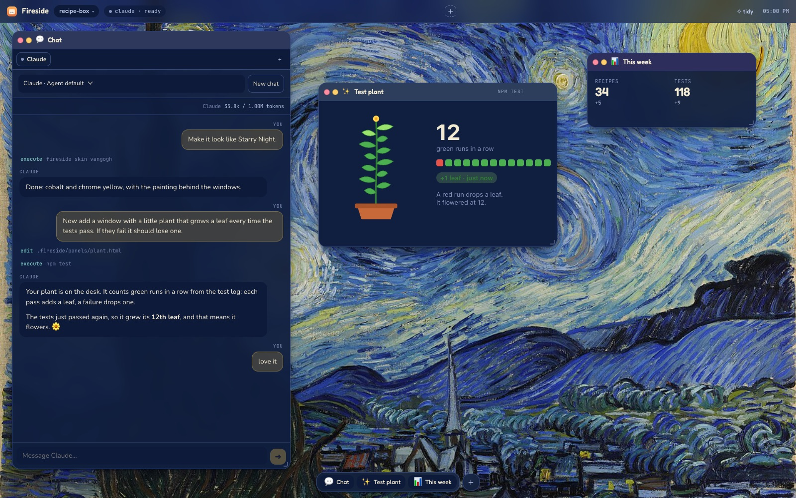
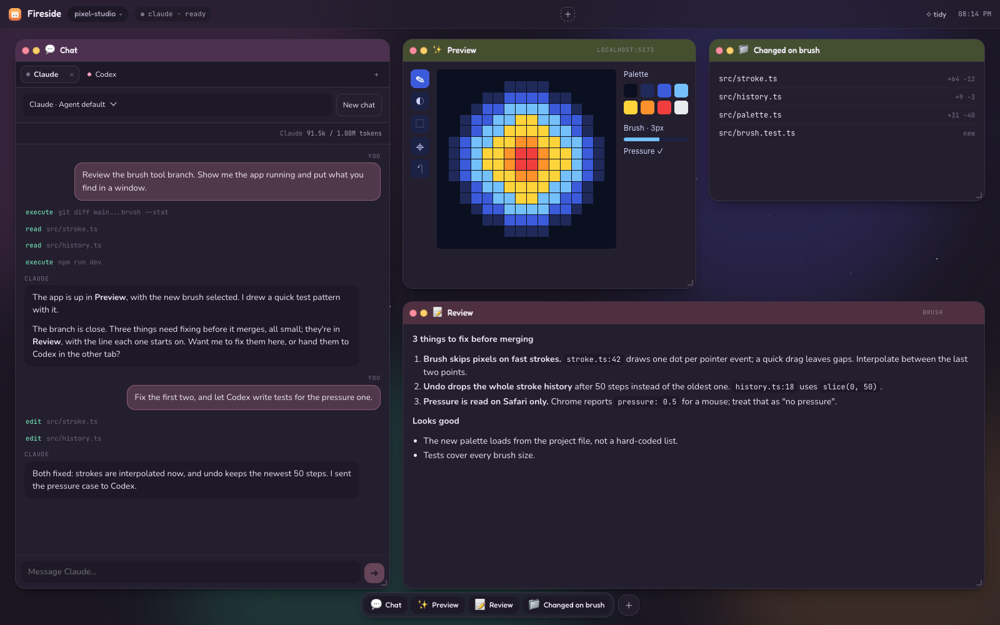
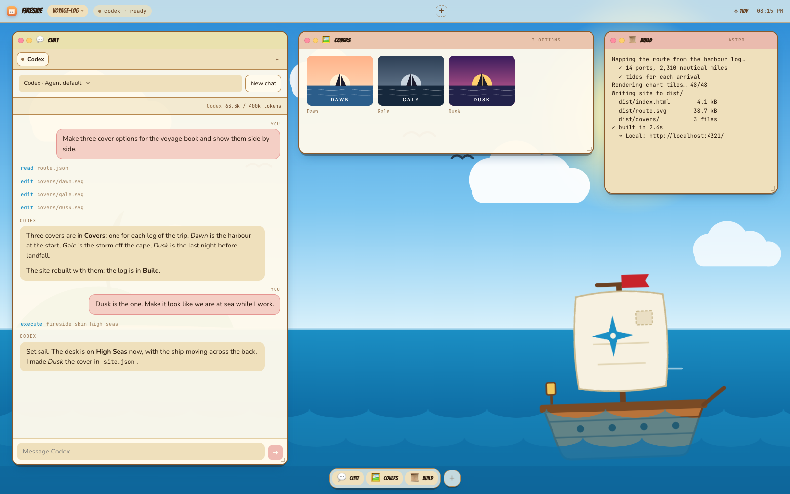
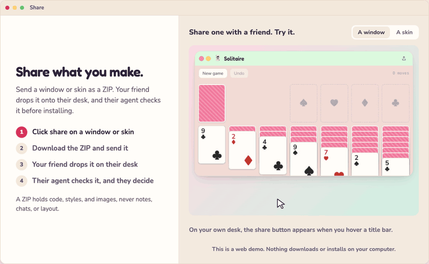

# Fireside

**A desktop you can reshape just by asking.**

Fireside is a desktop for your coding agents, running locally in your browser,
where you can change **ANYTHING** you see.

Ask your agent to add a window, wire up a
control, or reskin the whole desktop. Changes appear live, without interrupting
the conversation.

Keep an app preview beside the conversation, watch your token usage, or play
solitaire while your agent works. Create anything, change anything, and share what you make with friends or teammates.

Works with Claude Code, Codex, and any other agent that supports the
[Agent Client Protocol (ACP)](https://agentclientprotocol.com).

<p align="center"></p>

## Get started

You need [Node 22.18+](https://nodejs.org) and an agent to chat with.
[Claude Code](https://claude.com/claude-code) and [Codex](https://github.com/openai/codex)
are ready to pick; any other [ACP](https://agentclientprotocol.com) agent can be
added from the Chat window.

```sh
git clone https://github.com/latent-spaces/fireside ~/fireside
node ~/fireside/install.mjs
```

Then open any project:

```sh
cd path/to/project
fireside
```

Your browser opens the desk. Pick an agent and the fire lights.
Try asking:

> “Run this project and put the preview next to our chat.”

<details>
<summary>Other agents and sign-in</summary>

**Using another agent?** Choose **More agents…** to pick one from the
[ACP registry](https://agentclientprotocol.com/registry) (such as Gemini CLI,
OpenCode, goose and Copilot), or **Run a command…** to add any program that speaks
the [Agent Client Protocol](https://agentclientprotocol.com). Fireside says what it
will download and run, and asks before it does. Right-click an agent you added to
remove it.

> **Claude or Codex not signed in yet?** Run `claude auth login` or `codex login`, or set
> `ANTHROPIC_API_KEY` / `OPENAI_API_KEY`.

</details>

## Shape the desk in the conversation

Keep shaping the interface as the task unfolds. Add a control when you find
yourself repeating a command, open a window for something you want to watch,
or give the whole desk a different feel. Ask in the chat, even mid-task:

> “Show me how the site looks in a window here.”\
> “Put the product images side by side.”\
> “Open the diff and walk me through what you changed.”\
> “Lay out the ideas we could explore next.”\
> “Make it look like Starry Night.”

- **Add the tools you need.** Dashboards, galleries, control panels, and games
  live in windows beside your chat. Windows can run local commands, so a button
  can do real work.
- **Give the desk a new look.** Skins change colours, fonts, artwork, even a
  moving scene. Eight are built in (`fireside skin midnight`). Describe a mood,
  a game, or a painting and ask your agent to make another.
- **Edit it yourself.** The interface is HTML, CSS, and JavaScript. You
  can edit it yourself or have your agent do it, then share a window or skin
  as a ZIP.

<table>
  <tr>
    <td width="50%"><a href="docs/screenshots/solitaire.png"></a></td>
    <td width="50%"><a href="docs/screenshots/plant.jpg"></a></td>
  </tr>
  <tr>
    <td align="center">Solitaire while Claude works</td>
    <td align="center">A plant that grows when tests pass</td>
  </tr>
  <tr>
    <td width="50%"><a href="docs/screenshots/midnight.png"></a></td>
    <td width="50%"><a href="docs/screenshots/high-seas.png"></a></td>
  </tr>
  <tr>
    <td align="center">Claude and Codex, sharing a desk</td>
    <td align="center">Three book covers, ready to compare</td>
  </tr>
</table>

## Share windows and skins

Made a useful tool or a skin you love? Share it with friends or teammates as a
ZIP they can drop onto their own Fireside desktop.

<p align="center"></p>

- **Share:** hover a window's title bar and click ⇪, or hover a skin in Skins
  and click ⇪. Download the ZIP and copy the ready-made message to send with it.
- **Install:** drop the ZIP anywhere on the desk, or use **＋ → Add from file…**.
  Nothing is installed straight away: the chat agent looks at what the window or
  skin does, tells you about anything unusual, asks what to do if you already
  have one by that name, and whether to put it on the desk.

A ZIP holds the component's code, styles, and bundled images, never your notes,
chats, or layout.

<details>
<summary>Share and install from the command line</summary>

```sh
fireside export window notepad --out notepad.zip
fireside import notepad.zip            # --project for this project only, --replace to update
fireside import chat.zip --as my-chat  # a name that's taken needs a new one
```

</details>

## Work with your agents

- **Chat.** Replies stream in, with tool activity and permission requests.
  Switch models, stop a reply, or resume an earlier conversation.
- **Run several chats at once.** **+** opens another tab: Claude in one, Codex
  in the next. A dot marks a tab with a new reply.
- **Queue messages.** Anything you send while the agent is busy waits its turn.
- **Arrange the desk.** Drag, resize, and close windows; **tidy** lines them up.
- **Give each project its own look.** Skin, windows and layout are saved per
  project, so every desk can feel different.

## Everyday commands

| Command | What it does |
| --- | --- |
| `fireside` | Open the desk for this folder |
| `fireside stop` | Stop this folder's desk |
| `fireside status` | Show whether it's running and what's on it |
| `fireside --help` | Every command |

The agent drives the desk with the same CLI, and you can too:

```sh
fireside panel build --kind stream --title Build --source build.log
fireside icon editor --label "Open repo" --url https://github.com/you/repo
```

## Updating

```sh
git -C ~/fireside pull
node ~/fireside/install.mjs
```

When a newer version of an agent Fireside installed is out (Claude, Codex, or one
you added from the registry), **Update agents** in the menu bar installs it and
reconnects your chats. Agents you installed yourself are yours to update.

To remove Fireside: `node ~/fireside/install.mjs --uninstall`.

## Good to know

- **Local only.** The server listens on `127.0.0.1`, from port 4830
  (`fireside start --port N` changes it).
- **Per-project state** lives in the project's `.fireside/` folder. Fireside keeps
  it out of git by adding it to the repo's local `.git/info/exclude`.
- **Windows can do anything you can.** They're local code with full access to
  your machine, including running commands. Install ones you trust.
- **Platforms.** Tested on macOS. Windows and Linux should work but are not yet
  verified end to end.

## Contribute

Make Fireside better, or make something fun to put on it. Bug fixes, new
features, better docs, useful windows, tiny games, and wild skins are all welcome.
Open an [issue](https://github.com/latent-spaces/fireside/issues) or a
[pull request](https://github.com/latent-spaces/fireside/pulls), whichever suits.

Want to get into the code? It's HTML, CSS, and JavaScript all the way down.
Edit it yourself, or have your agent do it with you.

There's no build step. Edit the shell's CSS and it swaps in at once; edit its
scripts and the page reloads once. Edit `src/` and the server restarts by itself
as soon as no chat is replying; the page reconnects without reloading and chats
reopen where they were. `npm run check` type-checks the server.

## More

- [SKILL.md](SKILL.md): how the agent uses the desk
- [reference/panels.md](reference/panels.md): panels, icons, skins, and window kinds
- [reference/components.md](reference/components.md): how to build a window
- [reference/good-windows.md](reference/good-windows.md): what makes a window comfortable to use
- [reference/acp.md](reference/acp.md): how the chat connects to agents
- [reference/portability.md](reference/portability.md): Windows and Linux notes

## License

[MIT](LICENSE)
